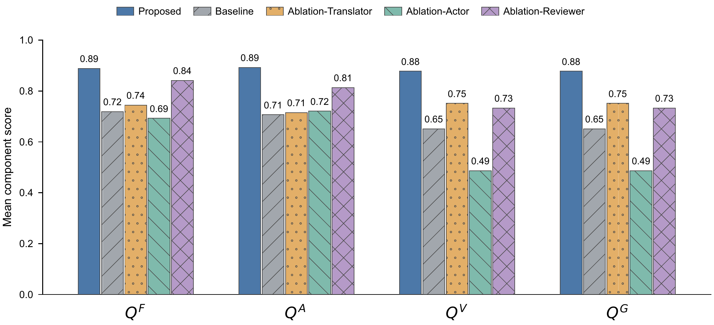
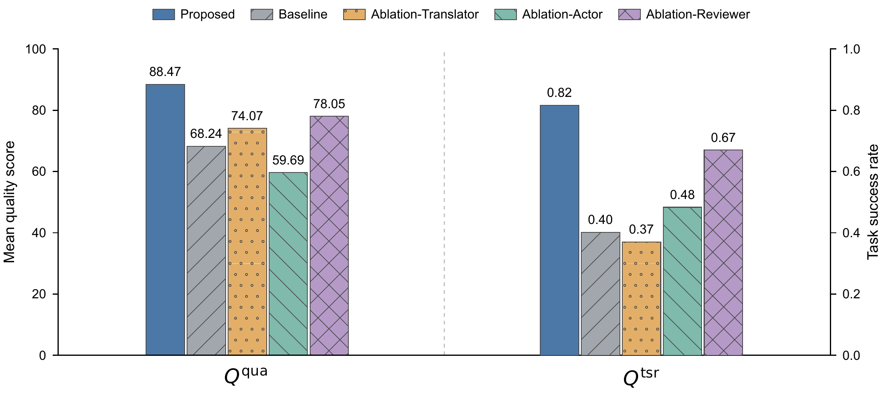
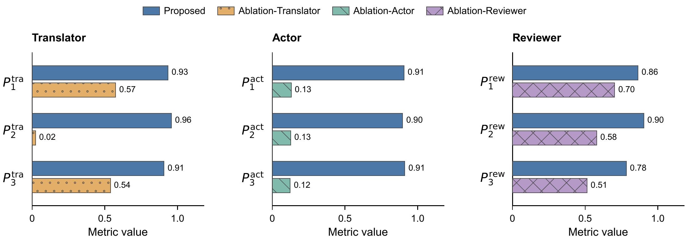
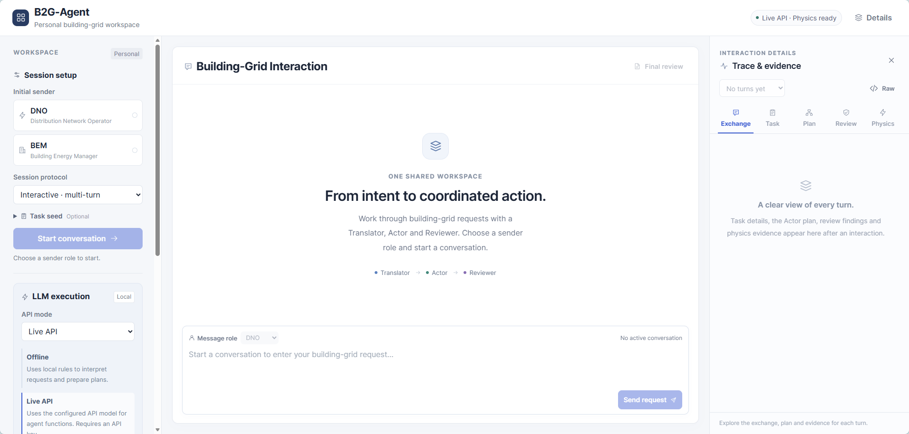

# B2G-Agent

B2G-Agent is a research toolkit and local browser interface for building-grid interactions. A Translator interprets messages, an Actor plans tool execution, and a Reviewer checks contracts and evidence and requests corrections. The study uses an IEEE 33-bus feeder, ten building energy managers, 15-minute intervals, and 200 fixed tasks repeated three times for each of five methods.

## Requirements

- **Python 3.12, 64-bit**, with pip and venv; checked with Python 3.12.14. [Python downloads](https://www.python.org/downloads/).
- **EnergyPlus 23.1.0** for physical simulation. Install the appropriate package from the [official release](https://github.com/NatLabRockies/EnergyPlus/releases/tag/v23.1.0). The supplied models are already transitioned to this version.
- The pinned packages in [pyproject.toml](B2G-Agent/pyproject.toml), including pandapower, the numerical stack, local embedding dependencies, FastAPI, and the LLM client. Node.js is not required.
- A browser and, for fresh live experiments, your own API key and access to the configured model. Archived-results verification does not require an API key.
- At least **100 GB** free to extract the complete study, plus space for new runs. The interface and fresh experiments initially require only the smaller input-data package.

The commands below describe the tested Windows/PowerShell workflow; other operating systems have not been validated for the complete case. Prefer a short checkout path on Windows because physical simulation creates deeply nested files. From the `B2G-Agent` directory:

```powershell
py -3.12 -m venv .venv
.\.venv\Scripts\python.exe -m pip install -e ".[dev,simulation,retrieval]"
Copy-Item .env.example .env
```

Edit the Git-ignored `.env`: set `OPENAI_API_KEY` to your own key, `B2G_ENERGYPLUS_EXE` to your EnergyPlus executable, and keep `B2G_DATA_ROOT=.local-data` for the supplied layout. Credentials are read by the local server, not entered in the browser. Never commit the populated file. The recorded study uses `gpt-6-luna` with `reasoning_effort=none`; access to that model is required to attempt the same live configuration. Substituting another model constitutes a different experiment.

## Data

Download packages and `release_manifest.json` from [Google Drive](https://drive.google.com/drive/folders/1qjqdioVLz8TaIZ21DyTY-DaEg0iaApLH). The author uploads these prepared packages separately from GitHub.

| Package | Contents |
| --- | --- |
| `b2g-input-data.zip` | `.local-data/`: weather, transitioned building models, load/price/reserve/PV profiles, calibrated thermal/grid models, knowledge-source snapshots, and the pinned local embedding model |
| `b2g-proposed.zip` | Proposed-method requests, responses, journals, scores, captured source snapshots, and physical evidence |
| `b2g-baseline.zip` | Baseline records and physical evidence |
| `b2g-ablation-translator.zip` | Final Translator records, retained recovery attempts, and physical evidence |
| `b2g-ablation-actor.zip` | Final Actor records and physical evidence |
| `b2g-ablation-reviewer.zip` | Final Reviewer records and physical evidence |
| `b2g-results.zip` | Final comparison, metric provenance, and Reviewer feedback audit |
| `b2g-publication.zip` | File inventory, original/published hash mappings, and redaction notes |

For new experiments or interface deployment, restore the inputs:

```powershell
.\.venv\Scripts\python.exe -B experiments\restore_release.py --archive-dir "<download-directory>" --include inputs
```

The helper verifies archive hashes and refuses to overwrite differing existing files. Use `--include all` in a separate checkout for the complete recorded study. The large `outputs/` tree is unnecessary for starting fresh experiments. GitHub already includes the small case definitions, all 200 tasks, reference answers, five protocols, frozen Reviewer memory, and knowledge records. See [data acquisition](B2G-Agent/docs/data-acquisition.md) for upstream sources and preparation scripts.

Drive records are **privacy-redacted copies**: personal paths and detected credentials are removed, including inside captured source archives. Numerical results and the final metric matrix are retained. Historical hash claims are explicitly paired with published hashes; the release is not claimed to contain byte-identical acquisition files. See [publication notes](B2G-Agent/docs/publication.md). Private interface conversations and learned personal memory are excluded.

## Experiments

### Methods and metrics

The small [reported matrix](B2G-Agent/results/reported_metrics.csv) is also included here for inspection.

| Method | Runner ID | Tasks x repeats |
| --- | --- | ---: |
| Proposed | `full_multi_agent` | 200 x 3 |
| Baseline | `same_llm_single_agent` | 200 x 3 |
| Ablation-Translator | `plain_translator` | 200 x 3 |
| Ablation-Actor | `unstructured_actor` | 200 x 3 |
| Ablation-Reviewer | `reviewer_no_feedback` | 200 x 3 |

Each ablation changes only its named agent implementation; resulting trajectories can still differ. The final vocabulary has 18 indicators: six quality, nine agent-performance, and three whole-system cost measures. Proposed has 18 applicable values, baseline nine, and each ablation 12. Non-target metrics are absent, not zero. Reviewer measures appropriate first handling, executable-task reverse-review reach, and executable-task success. These post-acquisition measures describe workflow effects rather than isolated diagnosis. See [evaluation protocol](B2G-Agent/docs/evaluation-protocol.md) and [ablation definitions](B2G-Agent/docs/ablation-evaluation.md).

### Reproduction

**Verify the reported experiment without new API calls.** Restore all packages in a separate checkout:

```powershell
.\.venv\Scripts\python.exe -B experiments\restore_release.py --archive-dir "<download-directory>" --include all
.\.venv\Scripts\python.exe -B experiments\verify_retained_layout.py
.\.venv\Scripts\python.exe -B experiments\reassess_reviewer_feedback_harms.py
.\.venv\Scripts\python.exe -B experiments\finalize_selected_reports.py
```

The verifier checks the five cohorts, journals, captured archives, and evidence using publication hash mappings. The Reviewer command recomputes its audit from recorded interactions. The finalizer validates that audit and republishes the approved matrix; it does not independently recompute every quality/cost value. Read `outputs/comparison/final/metrics.csv` and each method's `FINAL_METRICS.*`. The complete execution process, including intermediate failures and corrections, is available in Google Drive.

**Run the experiment again.** Use a clean checkout with only input data restored and configure your API key and EnergyPlus path:

```powershell
.\.venv\Scripts\python.exe -B experiments\validate_case.py --require-physics --require-publishable
.\.venv\Scripts\python.exe -B experiments\prepare_embedding_model.py --verify-only
.\.venv\Scripts\python.exe -B experiments\preflight_evaluation.py --mode live
.\.venv\Scripts\python.exe -B experiments\run_proposed_suite.py --method full_multi_agent --execute
.\.venv\Scripts\python.exe -B experiments\run_proposed_suite.py --method same_llm_single_agent --execute
.\.venv\Scripts\python.exe -B experiments\run_mechanism_ablations.py --execute
```

Omit `--execute` to prepare the selection without inference or simulation. With it, API calls incur charges. The last command executes the ablation groups sequentially; `--workers 1` limits each group to one worker. Each method has 600 attempts. Runners refuse to overwrite an existing canonical method directory, so keep restored historical outputs in a separate checkout. After ablation acquisition, run `report_proposed_suite.py --suite` with each method directory to calculate its report. Failed outcomes remain in the denominator.

Fresh results may differ because of API/model availability, service-side updates, stochastic generation, timing, software versions, and execution environment. Temperature zero and a seed do not guarantee identical cloud responses. Distributed source includes post-acquisition maintenance and publication support; captured acquisition snapshots provide provenance. Redaction changes request bytes, so exact-hash replay of published traces is not guaranteed; use the recorded-results verification route above to inspect the reported study.

### Results

These figures summarize the final five-method benchmark, with 200 tasks repeated three times per method. The agent panels compare Proposed with the corresponding ablation. Metric definitions and denominators are given in the [evaluation protocol](B2G-Agent/docs/evaluation-protocol.md); exact values are available in the [reported matrix](B2G-Agent/results/reported_metrics.csv). Click a preview to open the original PDF.

#### Quality components

[](B2G-Agent/results/figures/Fig-Quality_components.pdf)

#### Overall quality

[](B2G-Agent/results/figures/Fig-Quality_overall.pdf)

#### Agent performance

[](B2G-Agent/results/figures/Fig-Agent_performance.pdf)

## Critical file description

| Path | Purpose |
| --- | --- |
| `src/b2g_agent/agents/` | Agents, retrieval, baseline, and final ablations |
| `src/b2g_agent/contracts/` | Typed task, plan, review, and evidence contracts |
| `src/b2g_agent/orchestration/` | Exchanges, correction loops, and tool execution |
| `src/b2g_agent/simulation/` | EnergyPlus/pandapower adapters and optimization |
| `src/b2g_agent/evaluation/` | Quality, agent and cost metrics, protocols, caches |
| `cases/ieee33_10bem_15min/` | Frozen case, tasks, splits, oracles, memory, protocols |
| `knowledge/` | Domain knowledge, retrieval configuration, source references |
| `experiments/` | Data preparation, reference generation, acquisition, scoring, reporting, verification |
| `tests/` | Offline regressions without live API calls or workstation simulators |
| `src/b2g_agent/web/`, `start_personal.py` | Browser interface and launcher |
| `src/b2g_agent/artifact_paths.py`, `publication.py` | Relocated-path lookup and publication hash validation |

The complete preparation chain remains under `experiments/`, documented in [data acquisition](B2G-Agent/docs/data-acquisition.md). Use the frozen input package first: regenerating tasks, target days, calibration, or reference answers changes the benchmark.

## Interface



### Local setup

Complete Requirements and restore the input-data package. Historical outputs and the author's Personal-workspace are unnecessary. Start the local server:

```powershell
.\.venv\Scripts\python.exe -B start_personal.py --host 127.0.0.1 --port 8000
```

Open [http://127.0.0.1:8000](http://127.0.0.1:8000). Startup builds the local retrieval index and can take several minutes. The application creates a sibling `Personal-workspace/` for your settings, sessions, API records, journals, physics, and optional memory. The supplied template contains no author history and is optional; runtime files are created automatically.

Set your API key in `.env` before starting. **API mode** switches between Offline, Live API, and Replay for new sessions; existing sessions retain their original mode. Offline uses local rules and is not the paper's LLM method. Replay requires matching personal saved responses. Physical simulation requires EnergyPlus and input data in every interpretation mode.

### Usage instruction

1. Choose **DNO** or **BEM**. Select **Interactive** for multiple turns or **Benchmark** for a private one-exchange rehearsal.
2. Optionally choose a task family and episode seed, then **Start conversation**. Unseeded interactive sessions accept supported requests in your own wording.
3. Specify the building/bus, operating day, time window, service quantity, and constraints. Use the offered examples, then **Send request**. Supply missing information when clarification is requested.
4. Inspect **Exchange**, **Task**, **Plan**, and **Review** in **Trace & evidence**. When eligible, choose **Run physics**. A manual receiver reply can be recorded, but physical-output claims still require validation before release.
5. Inspect **Physics** and the final review. In Interactive mode, continue with another message; use the turn selector to revisit earlier exchanges. Interface runs never enter the formal experiment cohorts.

### Limitations

The interface supports the fixed IEEE 33-bus/ten-building case, prepared operating days, 15-minute resolution, seven implemented service families and their supported combinations. Free-form wording does not make arbitrary networks, new building models, unsupported services, or external data sources executable. Correction budgets are bounded; requests can require clarification or end blocked. Results are local simulations, not live equipment control, field measurements, or market settlement.

This is a local research interface without production multi-user authentication, deployment isolation, or field-device connectors; retain the default loopback binding. API and simulator failures are possible. Personal memory remains separate from benchmark memory. Future development will extend case configuration, tool/service coverage, execution recovery, interface guidance, and deployment capabilities.


